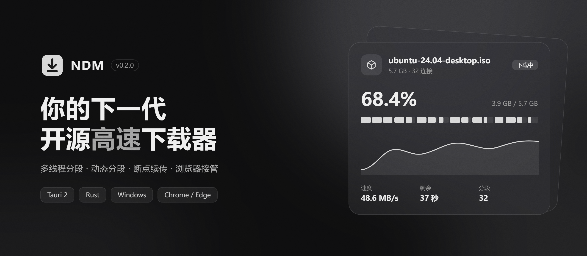
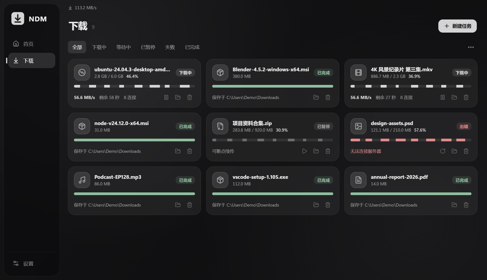

<p align="center">
  
</p>

<p align="center">
  <a href="https://github.com/fttawa/NDM/releases"></a>
  
  
  
</p>

<p align="center">
  多线程分段 · 动态分段 · SQLite 持久化 · 浏览器接管 · OpenList 整目录下载
</p>

---

官网：https://fttawa.github.io/NDM/

NDM 是一个基于 Tauri 2 + Rust 的多线程下载管理器，目标是成为 IDM 的开源替代品。界面参考 Motrix，采用 Bento Grid 布局、深色中性灰与毛玻璃材质，支持 HTTP、HLS 与 BT 下载。

<p align="center">
  
</p>

## ✨ 特性

| | |
| --- | --- |
| **多连接加速** | 每个任务 1–32 条连接，强制 HTTP/1.1，每个分段独占一条 TCP 连接 |
| **动态分段** | 空闲连接自动拆分剩余最多的分段接手，跑到最后也不掉速 |
| **连接超频** | 实测请求到服务器开始传输的延迟，预判即将传完或重试中的连接，提前补上新连接（最多加开连接数的一半）防止掉速 |
| **断点续传** | 分段进度持久化，崩溃或重启后从断点继续；服务器不支持 Range 时自动降级单连接 |
| **SQLite 存储** | 任务与设置使用 SQLite 保存，旧版 JSON 自动迁移；支持导入导出与损坏恢复 |
| **浏览器接管** | Chrome / Edge 扩展在「另存为」弹出前拦截下载，连同 Cookie、Referer、UA 一起转交 |
| **IDM 式小卡片** | 拦截后弹出置顶确认卡片，点击「开始下载」原地展开为进度窗口，不打扰主窗口 |
| **OpenList / AList** | 一键爬取当前文件夹（可含子文件夹），勾选后批量下载，保留目录结构与真实文件名 |
| **批量管理** | 复选框多选，Shift 连选、Ctrl+A 全选，批量开始 / 暂停 / 重新下载 / 删除 |
| **网络** | 全局限速、并发队列、系统代理 / 手动 HTTP · SOCKS5 代理 |
| **磁力与 BT** | BTv1、BTv2 和混合种子；内置原生 libtorrent 内核，支持校验与恢复 |
| **桌面体验** | 系统托盘、完成通知、剪贴板监听、亚克力 / 云母窗口材质 |

## 📦 安装

前往 [Releases](https://github.com/fttawa/NDM/releases) 下载 `NDM_x.y.z_x64-setup.exe` 安装即可（Windows 10 / 11，需要 WebView2，系统一般已自带）。

## 🧩 浏览器扩展

`extension/` 是 Chrome / Edge 扩展（MV3），安装包里也附带一份（设置 → 浏览器集成 → 打开扩展目录）。

1. 打开 `chrome://extensions`（Edge 为 `edge://extensions`），开启「开发者模式」
2. 点击「加载已解压的扩展程序」，选择扩展目录

扩展功能：

- 浏览器下载开始前拦截并转交 NDM；NDM 未运行时自动交还浏览器下载
- 右键链接 / 图片 / 视频：「使用 NDM 下载」
- 弹出面板可设置拦截开关、最小文件大小、文件类型、排除网站
- 在 OpenList / AList 页面，从扩展弹窗或右键菜单「下载当前文件夹」，使用当前登录身份与文件夹密码读取列表

> NDM 通过 `127.0.0.1:16800` 接收扩展请求，只接受来自浏览器扩展或本机程序的请求，普通网页无法添加任务。

## 🛠️ 开发

需要 Node.js / pnpm、Rust、Visual Studio C++ Build Tools / Windows SDK，以及 CMake、Ninja、Perl 和 NASM。Perl / NASM 仅用于编译静态 OpenSSL。`tauri dev` 和 `tauri build` 会自动下载并校验固定版本的原生依赖，首次构建较慢，后续复用 `.native-build/` 缓存。整个构建与运行流程不使用 Python。

```bash
pnpm install
pnpm tauri dev
```

只调 UI 时可以运行 `pnpm dev`，在浏览器中打开 http://localhost:1420（使用内置 mock 数据）。

| 环境变量 | 作用 |
| --- | --- |
| `NDM_DATA_DIR` | 使用独立数据目录，同时跳过单实例限制，便于与已安装的 NDM 并行测试 |
| `NDM_BRIDGE_PORT` | 更换扩展接入端口（默认 16800） |

测试前先运行 `pnpm build:bt-helper`。随后运行 `cargo test`（在 `src-tauri/` 下，下载引擎与 BT 元数据 / 路径校验）、`node scripts/test-bt-engine.mjs`（原生内核的 BTv1 / BTv2 / 混合种子本机传输测试）、`node extension/rules.test.mjs`（扩展拦截规则）。

### 打包

```bash
pnpm tauri build
```

产物位于 `src-tauri/target/release/bundle/nsis/`。

### 项目结构

```
src/            React 19 前端（zustand、lucide-react）
src-tauri/      Rust 后端：下载引擎、任务管理、扩展桥接、确认卡片窗口
native/bt/      原生 C++ libtorrent 桥接程序与仅供测试的本机做种端
scripts/        原生内核构建脚本与 BT 传输测试
extension/      Chrome / Edge 扩展（MV3）
docs/           官网（GitHub Pages）与 README 图片，头图源文件在 docs/banner/
```

## 📁 数据位置

任务与设置保存在 `%APPDATA%\com.ndm.app\state.db`（SQLite）。从旧版本升级时，首次启动会自动迁移同目录下的 `tasks.json` 和 `settings.json`。
设置页支持将任务与设置导出为 JSON 备份，也可以在暂停下载后恢复备份。若数据库损坏，启动时会自动把原文件重命名为 `state.db.corrupt-时间戳` 后重建。


## 数据恢复、诊断与版本检查

- 设置 → 数据备份：选择备份后先预览任务数量和设置变更；确认后自动生成 `before-import-*.json` 原数据备份，再用事务替换任务与设置。导入的未完成任务保持暂停，不移动下载文件。
- 数据库版本不兼容、被占用或权限不足时会保留原库并报告错误，仅确认损坏时才隔离重建。
- 设置 → 更新与诊断：手动查询 GitHub Release，查看更新说明并前往下载安装包。此入口不会静默安装更新。
- 诊断导出只包含版本、系统架构、数字任务状态和事件代码，不包含任务 URL、Cookie、代理密码、文件名或保存路径。事件记录保存在数据目录的 `diagnostics.jsonl`，按大小轮换。
- 完整数据备份包含原始任务链接、请求头与设置，请妥善保存。

## 视频嗅探与 HLS 下载

- 浏览器扩展面板提供「当前页面的视频」列表。播放视频后点击刷新，可转交检测到的 MP4、WebM、MOV 或 m3u8 资源；嗅探可单独关闭，并遵守排除网站设置，不记录无痕标签页。资源列表按标签页隔离，导航和关闭标签页时清理，仅保留最近 100 项。
- 更新已安装的扩展后，需要在 `chrome://extensions` / `edge://extensions` 重新加载，允许新增的网络请求观察权限。浏览器刷新视频页面后即可开始嗅探；不支持将 `blob:` 地址直接转成下载链接。
- 主窗口新建任务支持直接粘贴 m3u8；不带扩展名的播放列表可手动开启「HLS / m3u8 视频」。点击「解析清晰度」可选择主播放列表中的清晰度，默认按带宽选择最高可用项。扩展转交的 HLS 默认自动选择。
- 支持未加密、已结束的 HLS 点播：TS 分片按序合并为 `.ts`，fMP4 初始化分片和媒体分片合并为 `.mp4`；支持相对地址、重定向和字节范围。无需安装 FFmpeg，不进行转码。分片按顺序下载，共用代理、队列与全局限速；失败自动重试。
- HLS 暂停后继续会从头下载，传输期间显示已下载字节，结束后确定最终大小。直播、AES-128 / SAMPLE-AES / DRM、独立音视频轨、时间线切换和初始化分片切换会报告暂不支持，不生成成功文件。

验证命令：`node --test extension/media.test.mjs extension/sniffer.test.mjs`、`cargo test --manifest-path src-tauri/Cargo.toml hls::tests`。测试使用仓库内的三秒合成音视频样本与本地 HTTP 服务，不访问外部视频站点。

## 磁力与 BT 种子下载

- BTv1、BTv2 与混合种子统一使用原生 C++ libtorrent 2.1.1。内核及 OpenSSL 静态链接为一个程序，作为隐藏子进程运行，通过私有标准输入 / 输出通信，任务停止或主程序关闭后退出，无需额外客户端或语言运行时。
- 新建任务可粘贴 `magnet:?xt=urn:btih:…` 或纯 BTv2 的 `magnet:?xt=urn:btmh:1220…`（SHA-256，支持批量），或点击「打开种子文件」选择本地 `.torrent`，下载种子包含的全部文件。
- 支持 BTv1、BTv2 与混合种子，种子文件限制 16 MiB；磁力元数据解析超时后可重试。磁力可通过 DHT 和自带 Tracker 寻找 Peer，资源无在线 Peer 时需要等待。
- 每个任务使用独立内容文件夹，任务卡显示 BT 标识、Peer 数和下载进度，详情可查看 Info Hash 与文件列表。元数据保存在 SQLite 和完整备份中，原始 `.torrent` 移动或删除后仍可续传。
- 与其他下载共用队列、暂停/继续、失败重试和完成通知。继续或重启时重新校验已有分片，修复损坏内容；显式「重新下载」使用新目录并保留旧内容。下载期间遵循 BT 协议上传已取得的分片，完成后停止连接与做种。
- BT Peer、DHT 与 Tracker 当前直接联网，不复用 HTTP / HLS 代理。HTTP / HLS 与 BT 按活跃任务数分配设置中的限速额度，各 BT 任务可动态调整限速，不再要求 16 KiB/s 最低配额。
- 删除任务默认保留内容；勾选删除文件时仅删除种子列出的文件和空目录，保留额外放入的文件。重复 Info Hash 会提示使用已有任务；不安全的文件名和符号链接路径会被拒绝。

验证：先运行 `pnpm build:bt-helper`，再运行 `cargo test --manifest-path src-tauri/Cargo.toml torrent::tests` 与 `node scripts/test-bt-engine.mjs`，使用本机真实做种端与下载端，验证 BTv1 / BTv2 / 混合种子的磁力元数据解析、多文件传输、暂停取消、重启后校验修复与删除文件边界，不访问公网资源。测试可传入 `--helper 路径` 验证安装包解压出的内核。内核依赖的许可随安装包保存在 `licenses/`。
